I build products end to end, from the server to the web and the phone, in TypeScript and Swift. I don't call anything done until I've seen it work.

## Things I've shipped

  
  
  

- **[Porcelain](https://github.com/FabioFiorita/porcelain)**: a code review tool for changes made with AI coding assistants. The review follows the decisions behind a change, one stop at a time, instead of a list of files sorted by name. Open source, MIT.
- **[Tastik](https://tastik.fabiofiorita.com)**: for the lists that don't belong in a reminders app. Groceries with steppers, budgets that add up, kanban boards. On iPhone, iPad and inside ChatGPT.
- **[ItsMedTime](https://itsmedtime.fabiofiorita.com)**: medication reminders that get through Silent and Do Not Disturb, started for a real family need. MeuMedicamento in Brazil.

Tastik and ItsMedTime have **2,500+ downloads** on the App Store.

## How I work

1. **Prove it works.** Run the real thing and watch it work: the server, the browser, the phone.
2. **Strongest layer first.** A repeated mistake gets a type, a lint rule or a CI check, not a paragraph.
3. **Isolate parallel work.** Nothing shared by accident: not a branch, a port or a database.
4. **The codebase is the memory.** When a new way replaces an old one, the old one is deleted.
5. **Model the domain.** Name the data shape first and let the structure carry the rules.
6. **Adopt before build.** Use what exists; build only what makes the product different.
7. **Experience first.** When easy-to-build and good-to-use disagree, the person using it wins.

Each one comes with real examples on [my portfolio](https://portfolio.fabiofiorita.com/#principles).

## Stack

TypeScript · React · React Native · Expo · Swift · SwiftUI · Node · NestJS · Effect · PostgreSQL · SQLite · Cloudflare

## Say hi

[Portfolio](https://portfolio.fabiofiorita.com) · [LinkedIn](https://www.linkedin.com/in/fabiofioritapontes/) · [X](https://x.com/flfiorita) · [Medium](https://medium.com/@fabiolfp) · fabiolfp@gmail.com
